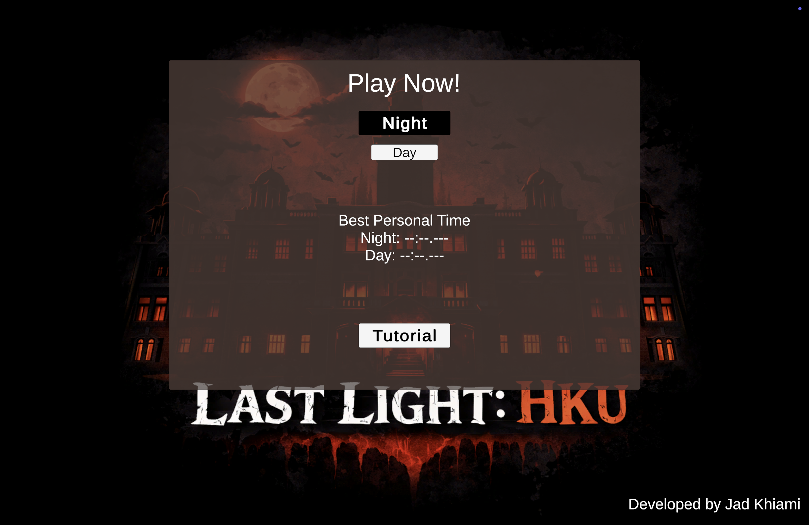
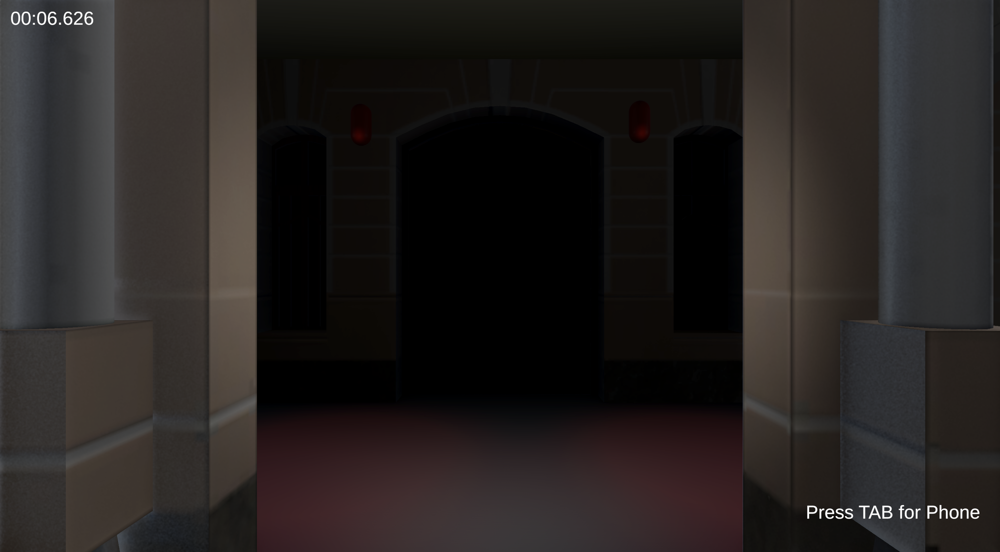
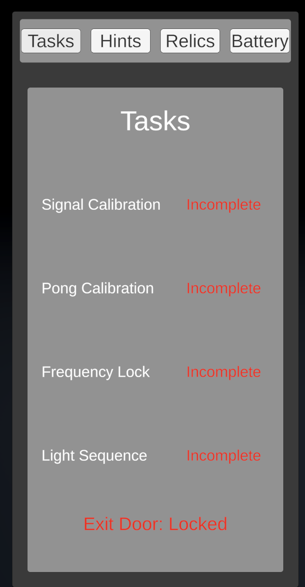
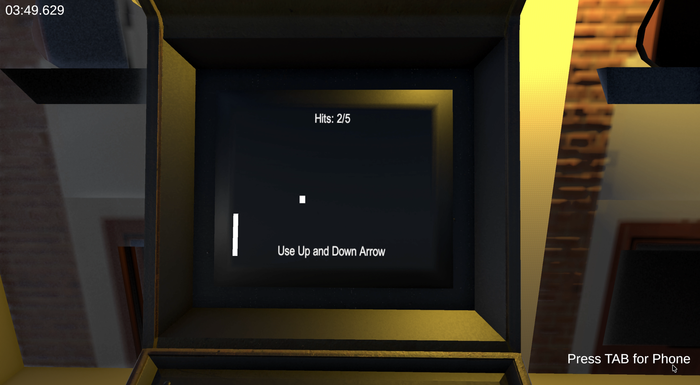

# Gameplay walkthrough

## Goal

Complete the four arcade console tasks, then find and reach the exit. Collecting the six relics is optional. Use the phone to check task progress, hints, relics, and battery.

## Controls and tips

- Move with **W / A / S / D** and look with the mouse.
- Press **Tab** to open or close the phone. Use its tabs to review Tasks, Hints, Relics, and Battery.
- Press **F** to toggle the flashlight. The phone and flashlight share one battery, and both drain it while in use.
- Approach a console and press **E** when its prompt appears.
- Press **Esc** to open the in-game menu.

The phone's Tasks page names the four consoles and changes the exit status to unlocked when all four are complete. If the flashlight battery runs out, the phone and flashlight switch off.

## Console mini-games

1. **Signal Calibration:** Tap **Space** to fill the signal bar. The bar slowly loses progress between taps, so keep tapping until it reaches 100%.
2. **Pong Calibration:** Move the left paddle with **W / S** or the **Up / Down Arrow** keys. Return the ball five times. A miss resets the hit count.
3. **Frequency Lock:** Watch the moving cursor and press **Space** while it is inside the target area. Land three locks; a miss resets the count.
4. **Light Sequence:** Watch the four tiles flash, then repeat the pattern with number keys **1–4**. An incorrect entry replays the sequence.

## Screenshots

The title screen below was captured from the downloadable public build. The other captures document the submitted game's first-person view, task phone, and Pong console. The public build substitutes simple original geometry for excluded licensed models and scans, so some scenery in those submission captures can differ from the public build.

## Public build notes

The macOS release is built from the sanitized Unity project. Its scenes replace excluded tree and spotlight prefabs with simple geometry, and replace the six merchandise scan pickups with generic shapes while preserving their pickup IDs and task interactions. The original packs and scan files are not included. See [CREDITS.md](../CREDITS.md) for attribution and license details.
